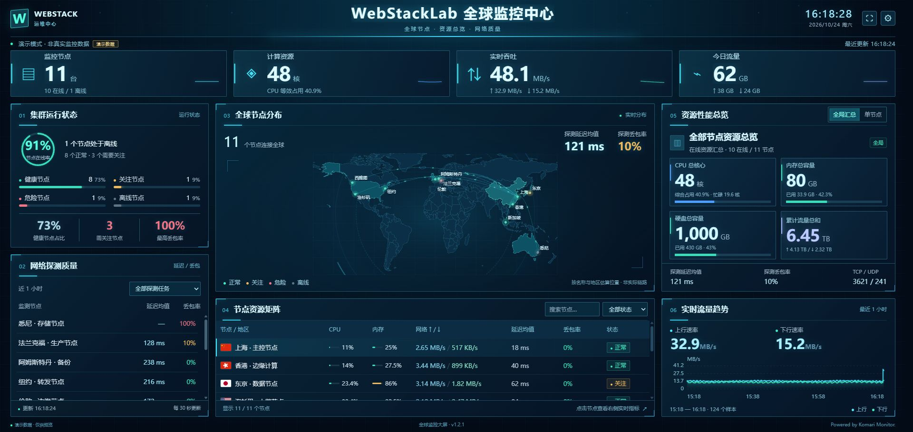

# WebStackLab · Komari 全球监控大屏

中文科技风 Komari 主题：全球节点地图、资源汇总、今日流量、Ping 延迟和丢包率。兼容目标为 Komari 1.6.x，不是独立监控服务。



## 安装

从本仓库 Releases 下载 `WebStackLab-Observatory-v1.2.2.zip`，在 Komari 后台「主题管理」中上传并启用。

请使用主题安装包，GitHub 自动生成的 “Source code” 源码 ZIP 不能直接作为主题安装。

也可以下载源码，运行 `python package_theme.py`，安装包将生成在 `release/`。原主题可在后台切换回来。

## 自定义标题

进入「主题管理 → 大屏设置」：

| 设置 | 修改位置 |
| --- | --- |
| 左上角品牌名称 | 左上角默认的 `WEBSTACK` |
| 左上角品牌副标题 | 品牌下方默认的“运维中心” |
| 左侧标识文字 | 左上角方形标识里的 `W`，建议 1–2 个字符 |
| 大屏标题、副标题 | 页面顶部中央标题 |

更新到 v1.2.2 后刷新后台主题设置页，保存设置再刷新首页。长品牌名称会省略显示，悬停可看完整名称。

## 功能

- 中文三栏大屏，兼容宽屏和手机；全屏、节点轮播和暂停。
- 全球地图、国旗、节点选择联动和动态链路；地图为地区示意，连线不是实际网络路径。
- 全局 CPU 逻辑核心数、内存和磁盘容量、累计流量；可切换单节点仪表。
- 今日上下行流量，默认按北京时间零点统计，可选 UTC 或浏览器时区。
- 最近一小时 Ping 加权平均延迟、丢包率；支持切换探测任务。
- 可搜索、筛选的节点资源表，异常状态综合资源占用和丢包率。
- 同源公开接口，WebSocket 优先，HTTP 回退；不需要管理员 API Key。
- 版本化合并资源、异步地图加载、固定尺寸占位；已移除扫描线、扫光和标题两侧斜纹。

数据口径、接口、阈值、地图配置和历史更新见 [详细使用说明](docs/使用说明.md)。

## 本地开发

需要 Python 3.10+；运行测试另需 Node.js 18+。不需要 npm 安装依赖。

```sh
python build_assets.py
node --check dist/assets/bundle.js
node analytics.test.cjs
python preview.py
```

打开 `http://127.0.0.1:8765/?demo=1`，使用有明确标识的演示数据。预览服务仅监听本机地址，默认不连接任何监控站点。

可选：读取自己 Komari 的公开接口进行本地联调：

```sh
python preview.py --remote https://monitor.example.com
```

这时打开 `http://127.0.0.1:8765/`。本地预览使用 HTTP 回退；安装后的主题会优先使用 WebSocket。代理仅开放列出的公开查询接口，不转发登录凭据。

修改 `dist/assets/app.js`、`analytics.js` 或源 CSS 后运行 `python build_assets.py`。生成地图：`python build_map.py`。最后运行 `python package_theme.py` 生成安装包。

## 目录

```text
komari-theme.json       主题清单及后台设置
dist/index.html        页面骨架
dist/assets/           源码、合并资源、地图和国旗
world-source.geojson   Natural Earth 原始数据
build_assets.py        合并样式和业务脚本
build_map.py           生成地图几何
package_theme.py       构建并打包可安装主题
preview.py             本机预览
analytics.test.cjs     指标汇总测试
docs/                  完整使用说明
```

## 数据与隐私

主题不会修改节点、Agent、数据库或远程控制设置。请勿把 Token、密码、真实配置、数据库、精确家庭地址或含私人信息的截图提交到仓库。主题设置及示意坐标可能公开可见。

“今日流量”依赖服务端保存的流量增量；无记录时显示 `—`。CPU、内存和磁盘容量汇总当前在线节点，累计流量包含已知离线节点上报的计数。具体兼容性取决于 Komari 服务端的公开接口。

## 贡献与许可

欢迎提交 Issue 和 Pull Request；报告问题时请附浏览器、Komari 版本、主题版本及不含敏感信息的截图。

主题代码使用 [MIT License](LICENSE)。Natural Earth 地图数据属于公共领域，来源见 [资源说明](LICENSES.md)。本项目为第三方主题，与 Komari 官方无隶属关系。

Powered by Komari Monitor.
